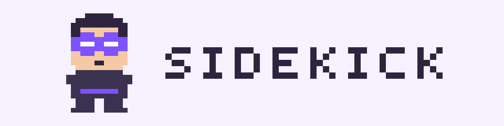
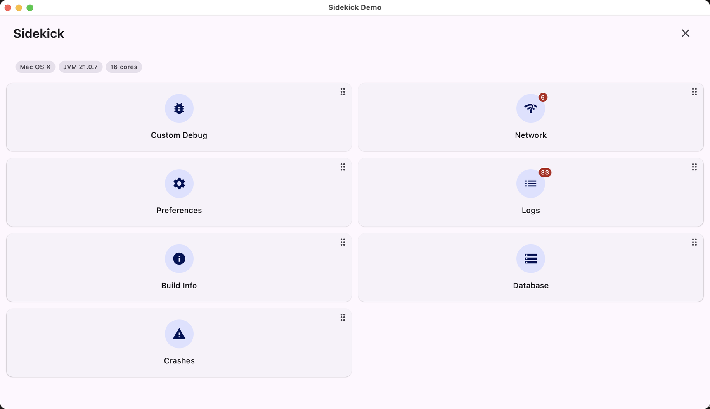

<picture>
  <source media="(prefers-color-scheme: dark)" srcset="assets/readme/hero-dark.svg">
  
</picture>

<p align="center">
  <strong>A Kotlin Multiplatform debug panel for Compose apps.</strong><br/>
  Network inspector, log viewer, database browser, crash reports, typed preferences and custom
  screens — in one composable your app renders however and whenever you want during development.
</p>

<p align="center">
  
  
  
  
</p>

<p align="center">
  
  
  
  
  
</p>

<p align="center">
  <a href="https://jipariz.github.io/sidekick/"><strong>Documentation</strong></a> ·
  <a href="https://jipariz.github.io/sidekick/demo/"><strong>Live demo</strong></a> ·
  <a href="docs/installation.md">Installation</a> ·
  <a href="docs/quick-start.md">Quick start</a>
</p>

---

## What it looks like

Every screenshot below is the `demo/` app running on Desktop (JVM) — the same composable renders on
Android, iOS and the browser.

| | |
|---|---|
|  |  |
| **The panel.** Your plugins in a grid, with live counters. The host app decides when it appears. | **Network monitor.** Every HTTP call, with status, timing, size, headers and bodies. |
|  |  |
| **Log monitor.** Searchable, level-filtered, no ADB needed. | **Database inspector.** Your app's own SQLite tables, with editable cells. |

## Why Sidekick

- **Inspect HTTP traffic without a proxy** — Ktor integration is built in; any other client plugs in through a low-level store API.
- **Read logs without ADB** — a Kermit bridge ships out of the box; Timber and friends drop in via a four-line `LogCollector`.
- **Flip feature flags from the panel** — annotate a class and KSP generates the DataStore wiring plus a ready-made UI.
- **Zero release-build cost** — every module has a matching noop, so release binaries carry no Sidekick UI and no database code. See [Release builds](docs/release-builds.md).
- **One codebase, five targets** — Android, iOS, Desktop (JVM), Web (JS) and Web (Wasm), on Compose Multiplatform.

## Built-in plugins

| Plugin | What it does | Platforms |
|---|---|---|
| [**Network Monitor**](docs/plugins/network-monitor.md) | Captures every HTTP request and response. Ktor built in; OkHttp and others via `NetworkMonitorStore`. | all five |
| [**Log Monitor**](docs/plugins/log-monitor.md) | Colour-coded log feed with level chips and search. Kermit bridge built in. | all five |
| [**Crash Monitor**](docs/plugins/crash-monitor.md) | Fatal and handled exceptions, readable on the next launch. | all five |
| [**Preferences**](docs/plugins/preferences.md) | Typed settings UI generated from `@Preference` annotations via KSP. | all five ¹ |
| [**Custom Screens**](docs/plugins/custom-screen.md) | Wrap any Composable as a debug card. Full DI access. | all five |
| [**Database Inspector**](docs/plugins/database-inspector.md) | Browse and edit your app's own SQLite tables, with a read-only SQL console. | Android, iOS, Desktop ² |
| [**Your plugin**](docs/plugins/custom-plugin.md) | Implement `SidekickPlugin` — your own module, your own DI scope, anything goes. | whatever you publish |

<sub>¹ Wasm keeps preferences in memory (DataStore has no Wasm driver), so values do not survive a reload.</sub><br/>
<sub>² `sqlite-web` mis-reports column types, so the web panel shows an unsupported state instead of wrong data.</sub>

## Install

Pin the **BOM** once and every other dependency line is version-agnostic. It is calendar-versioned
(`YYYY.MM.DD`) — the badge above shows the latest.

```kotlin
// build.gradle.kts
kotlin {
    sourceSets {
        commonMain.dependencies {
            implementation(platform("dev.parez.sidekick:bom:2026.09.11"))

            // `compileOnly` gives commonMain the types without putting the real
            // plugin jars on the release runtime classpath, where they would
            // collide with the noop variants.
            compileOnly("dev.parez.sidekick:network-monitor-ui")
            compileOnly("dev.parez.sidekick:network-monitor-ktor")
            compileOnly("dev.parez.sidekick:log-monitor-ui")
            compileOnly("dev.parez.sidekick:log-monitor-kermit")
        }
    }
}

dependencies {
    // Android. The same shape repeats per source set on other targets.
    debugImplementation("dev.parez.sidekick:shell")
    releaseImplementation("dev.parez.sidekick:noop")

    debugImplementation("dev.parez.sidekick:network-monitor-ui")
    debugImplementation("dev.parez.sidekick:network-monitor-ktor")
    releaseImplementation("dev.parez.sidekick:network-monitor-noop")
    debugImplementation("dev.parez.sidekick:log-monitor-ui")
    debugImplementation("dev.parez.sidekick:log-monitor-kermit")
    releaseImplementation("dev.parez.sidekick:log-monitor-noop")
}
```

`debugImplementation` and `releaseImplementation` are Android-only. Desktop, iOS and web pick the
real or noop module per source set, and the Preferences plugin needs its KSP processor wired —
both are covered in **[Installation](docs/installation.md)**, along with the version catalog
snippet and the Kotlin / Compose Multiplatform **[compatibility matrix](docs/installation.md#compatibility)**
you need to match.

## Wire it into your app

Sidekick renders the panel and nothing else. Your app owns the trigger and the visibility — a FAB, a
shake gesture, a build-type check, whatever you like. The trailing `actions` slot is where the close
button goes.

```kotlin
@Composable
fun App() {
    val networkPlugin = remember { NetworkMonitorPlugin() }
    val logPlugin = remember { LogMonitorPlugin() }
    var sidekickVisible by remember { mutableStateOf(false) }

    MaterialTheme {
        Box(Modifier.fillMaxSize()) {
            MyAppContent()

            SmallFloatingActionButton(
                onClick = { sidekickVisible = true },
                modifier = Modifier.align(Alignment.BottomEnd).padding(16.dp),
            ) {
                Icon(Icons.Default.BugReport, contentDescription = "Open Sidekick")
            }

            AnimatedVisibility(
                visible = sidekickVisible,
                enter = slideInVertically(initialOffsetY = { it }) + fadeIn(),
                exit = slideOutVertically(targetOffsetY = { it }) + fadeOut(),
            ) {
                Sidekick(
                    plugins = listOf(networkPlugin, logPlugin),
                    actions = {
                        IconButton(onClick = { sidekickVisible = false }) {
                            Icon(Icons.Default.Close, contentDescription = "Close")
                        }
                    },
                )
            }
        }
    }
}
```

Crash capture is the one exception: install it from your entry point, not from a plugin constructor,
or it will miss the startup crashes you most want to see.

```kotlin
CrashMonitor.install(appPackagePrefix = "com.acme.app")
```

## Contributing

Contributions welcome. The module layout, build conventions and the reasoning behind the plugin
system live in [`CLAUDE.md`](CLAUDE.md); the workflow is in [`CONTRIBUTING.md`](CONTRIBUTING.md).

```bash
./gradlew allTests                                    # every module
./gradlew detekt ktfmtCheck metalavaCheckCompatibility # the PR gates
./gradlew publishToMavenLocal --no-configuration-cache # local snapshot
```

## License

Apache 2.0 — see [LICENSE](LICENSE).

## Credits

The demo app uses [PokéAPI](https://pokeapi.co), a free and open RESTful Pokémon API — see
[pokeapi.co/about](https://pokeapi.co/about) for its license and usage terms.

Sidekick's network monitor was inspired by [KtorMonitor](https://github.com/CosminMihuMDC/KtorMonitor)
by Cosmin Mihu. Go and look at everything else that library does.
