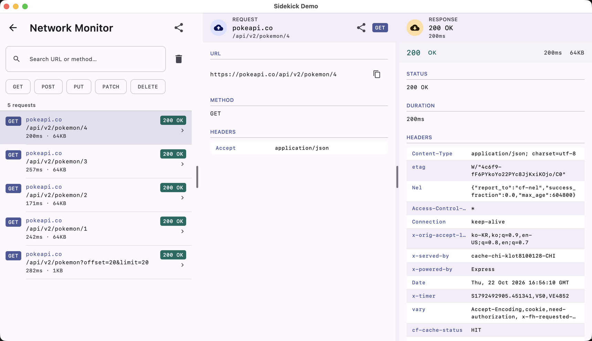
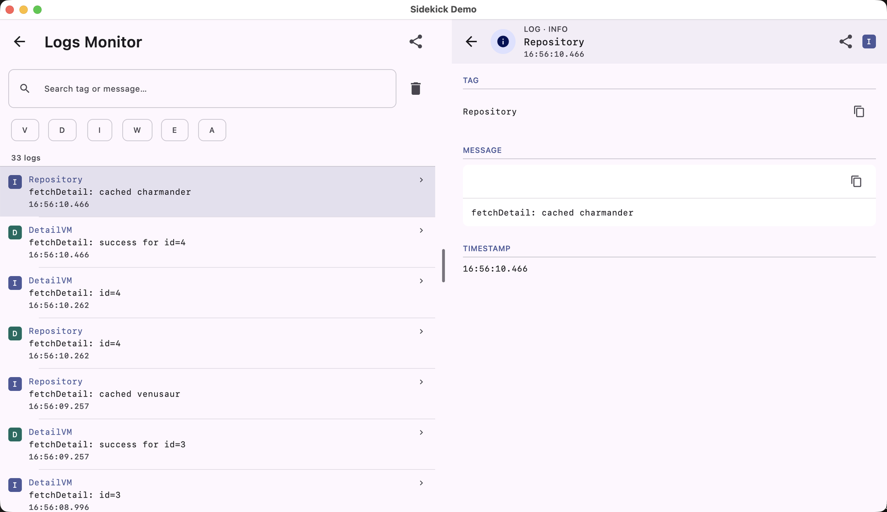
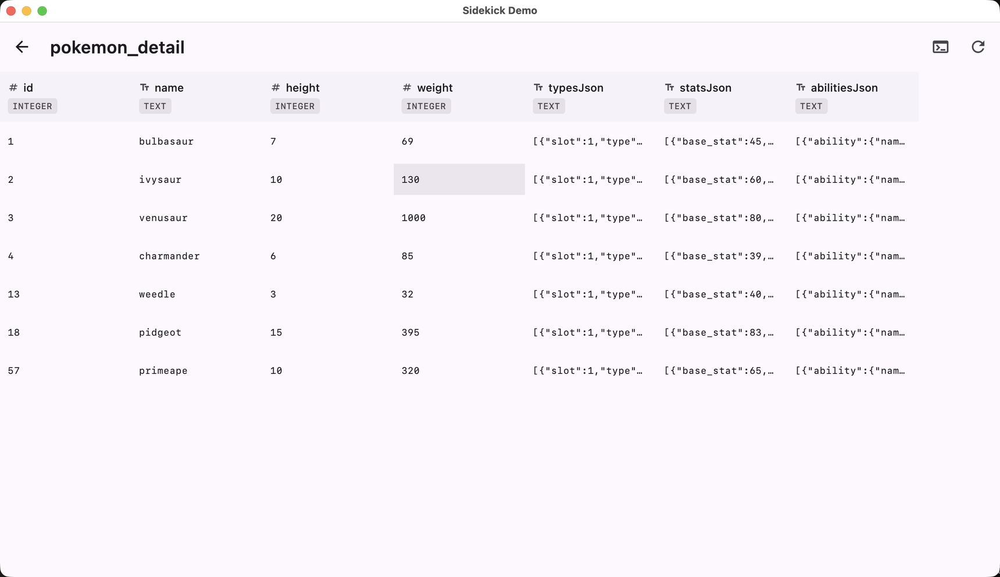

# Sidekick

<div class="sk-hero" markdown>


</div>

**A Kotlin Multiplatform debug panel for Compose apps** on Android, iOS, Desktop (JVM) and Web (JS / Wasm).

[](installation.md)


-4E8EE9?logo=openjdk&logoColor=white)
-F7DF1E?logo=javascript&logoColor=black)
-654FF0?logo=webassembly&logoColor=white)

!!! tip "Version numbers live in one place"
    The badges deliberately carry no Kotlin or Compose Multiplatform version — they went stale
    the last time they did. The [compatibility matrix](installation.md#compatibility) is the
    single source of truth for what each BOM was built against.

Sidekick is a debug panel composable you render in your app during development — network inspector, log viewer, preferences editor, custom screens. Your app controls when and how it's shown. In release builds, a no-op module replaces it with a passthrough composable at zero overhead.

<div style="text-align: center; margin: 2rem 0;">
  <a href="demo/index.html" class="md-button md-button--primary" style="margin-right: 0.5rem;">
    Live Demo
  </a>
  <a href="installation/" class="md-button">
    Get Started
  </a>
</div>

---

## What it looks like

Every shot below is the `demo/` app on Desktop (JVM) — the same composable renders on Android,
iOS and in the browser.

<div class="sk-shots" markdown>




</div>

---

## Why Sidekick

- **One panel, many tools** — built-in network inspector, log viewer, typed preferences editor, custom Composables.
- **Pluggable** — implement `SidekickPlugin` to add anything else.
- **Zero release cost** — `core:noop` replaces the panel with a passthrough composable, and `network-monitor:noop` / `log-monitor:noop` strip the recording layer; release binaries don't contain a single byte of Sidekick UI or database code.
- **Compose Multiplatform** — single UI codebase across Android, iOS, Desktop, and Web.
- **Visibility is yours to control** — Sidekick renders the panel; the host app decides when to show it (FAB, shake gesture, build-type check, anything).

## Built-in Plugins

| Plugin | What it does |
|--------|-------------|
| [Network Monitor](plugins/network-monitor.md) | Captures and displays all HTTP traffic via Ktor (or any client via `NetworkMonitorStore`). |
| [Log Monitor](plugins/log-monitor.md) | Displays app logs with level filtering and search (Kermit built-in, any SDK via `LogCollector`). |
| [Database Inspector](plugins/database-inspector.md) | Browses and edits the app's own SQLite tables, with a read-only SQL console. Native targets only. |
| [Crash Monitor](plugins/crash-monitor.md) | Captures fatals and handled exceptions, readable on the run after the crash. |
| [Preferences](plugins/preferences.md) | Exposes typed settings in the panel — KSP code generation or manual DataStore bridging. |
| [Custom Screens](plugins/custom-screen.md) | Wraps any Composable as a first-class debug screen. |

## Quick Example

```kotlin
@Composable
fun App() {
    val networkPlugin = remember { NetworkMonitorPlugin() }
    val plugins = remember { listOf(networkPlugin) }

    MaterialTheme {
        var sidekickVisible by remember { mutableStateOf(false) }
        Scaffold(
            floatingActionButton = {
                FloatingActionButton(onClick = { sidekickVisible = true }) {
                    Icon(Icons.Default.BugReport, contentDescription = "Open Sidekick")
                }
            },
        ) {
            Box(Modifier.fillMaxSize().padding(it)) {
                // your app content
                AnimatedVisibility(visible = sidekickVisible) {
                    Sidekick(
                        plugins = plugins,
                        actions = {
                            IconButton(onClick = { sidekickVisible = false }) {
                                Icon(Icons.Default.Close, contentDescription = "Close")
                            }
                        },
                    )
                }
            }
        }
    }
}
```

A FAB appears in the bottom-right corner. Tap it to open the Sidekick panel.

---

Ready to add Sidekick to your project? Start with [Installation](installation.md).

---

## Credits

The demo app uses data from [PokéAPI](https://pokeapi.co) — a free, open RESTful Pokémon API. See [pokeapi.co/about](https://pokeapi.co/about) for license and usage details.

Sidekick's network monitor was inspired by [KtorMonitor](https://github.com/CosminMihuMDC/KtorMonitor) by Cosmin Mihu. Go check out all the great features the library offers.
